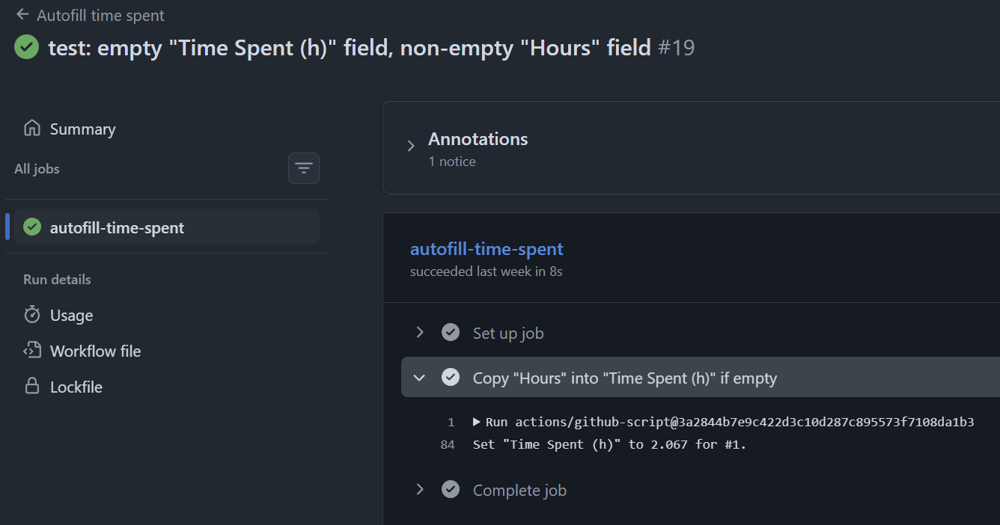
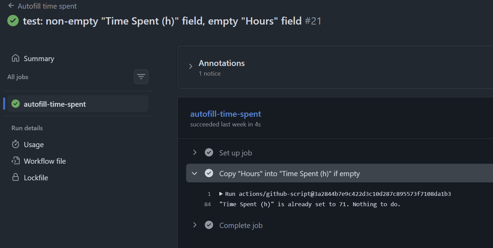
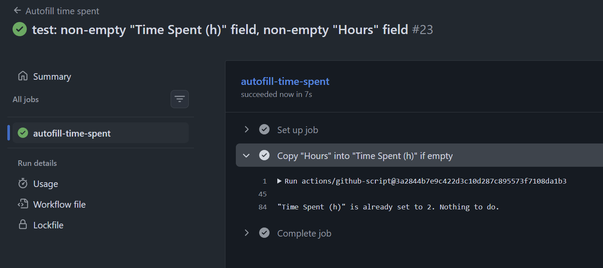
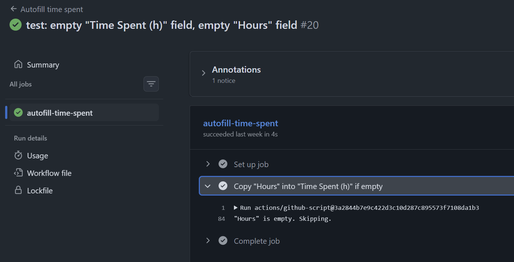
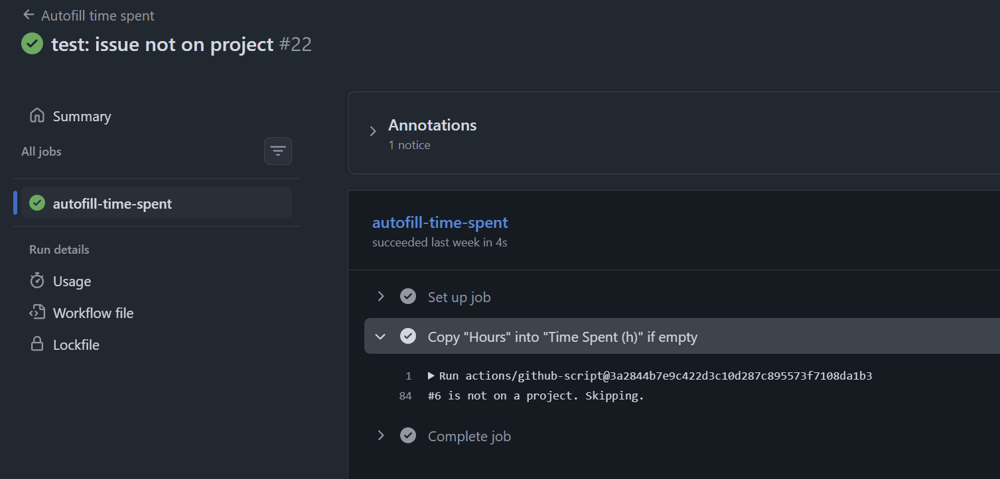
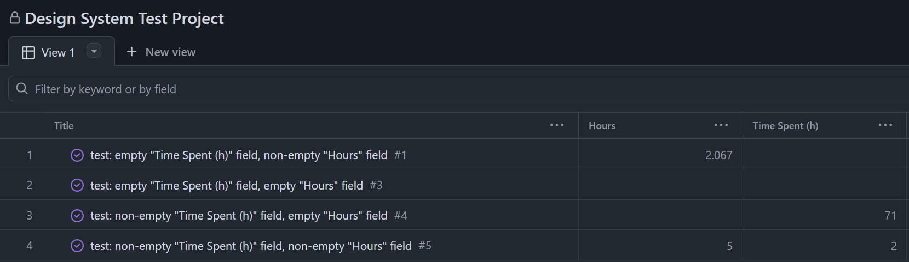
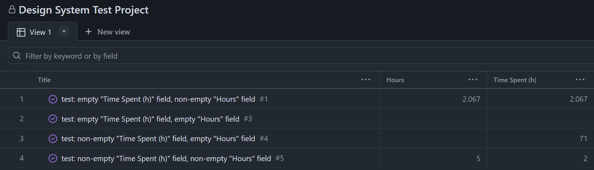

# GitHub Workflow to Autofill a Project Field

## Overview

I made my first open-source contribution ever. The repo `swisspost/design-system` used a GitHub
project to track remaining work. Two of its fields included "Hours" (the estimated time a task would
take) and "Time Spent (h)" (the actual time spent on the task). The feature request (linked below)
asked for a GitHub workflow to autofill "Time Spent (h)" (if empty) with the value from "Hours."
Thus, unless otherwise stated, this amounts to "a task took as long as we estimated."

My contribution was implementing that new workflow and thoroughly testing my implementation before
opening a PR. While the scope was tight (just a single `.yaml` file), I ended up learning quite a
few new things, both technical skills and contribution etiquette. As of writing this, my PR is still
open without any maintainer action.

[**Issue / feature request (#8480)**](https://github.com/swisspost/design-system/issues/8480)

[**My PR (#8824)**](https://github.com/swisspost/design-system/pull/8824)

## What happened

### Tested each case by hand

`design-system` suggested using `act` for testing GitHub Actions locally. I looked into it, but soon
realized that it could not mock projects locally. Thus, I opted for testing my new workflow on each
case on my fork using a temporary project. I identified 5 test cases (listed below), each with its
own issue. Four of the issues were linked to the project. The remaining issue wasn't linked to any
projects (which itself is a test case).

Test cases with GitHub action output:

**1. "Time Spent (h)" is empty; "Hours" is not empty** (happy path)



**2. "Time Spent (h)" is not empty; "Hours" is empty**



**3. "Time Spent (h)" is not empty; "Hours" is not empty**



**4. "Hours" is empty; "Time Spent (h)" empty**



**5. Issue not on a project**



Before running the workflow:



After running the workflow:



### Reduced over-engineering

Originally, my workflow tried to identify the first 20 projects an issue was on and update all their
"Time Spent (h)" fields as long as they were numerical:

```diff
diff --git a/.github/workflows/autofill-time-spent.yaml b/.github/workflows/autofill-time-spent.yaml
index dfebe1a33..526e3ef0e 100644
--- a/.github/workflows/autofill-time-spent.yaml
+++ b/.github/workflows/autofill-time-spent.yaml
@@ -24,6 +24,9 @@ jobs:
         with:
           github-token: ${{ secrets.SWISSPOSTDEVS_ACCESS_TOKEN }}
           script: |
+            // Project board: https://github.com/orgs/swisspost/projects/3
+            const PROJECT_OWNER = 'swisspost';
+            const PROJECT_NUMBER = 3;
             const ESTIMATE_FIELD = 'Hours';
             const SPENT_FIELD = 'Time Spent (h)';
             const issueNumber = Number(process.env.ISSUE_NUMBER);
@@ -32,14 +35,15 @@ jobs:
               `query ($owner: String!, $repo: String!, $number: Int!, $estimate: String!, $spent: String!) {
                 repository(owner: $owner, name: $repo) {
                   issue(number: $number) {
-                    projectItems(first: 20) {
+                    projectItems(first: 10) {
                       nodes {
                         id
                         project {
                           id
-                          title
+                          number
+                          owner { ... on Organization { login } }
                           spentField: field(name: $spent) {
-                            ... on ProjectV2Field { id dataType }
+                            ... on ProjectV2Field { id }
                           }
                         }
                         estimate: fieldValueByName(name: $estimate) {
@@ -62,43 +66,39 @@ jobs:
               },
             );

-            const items = (repository.issue?.projectItems.nodes ?? []).filter(
-              item => item.project.spentField?.dataType === 'NUMBER',
+            const item = repository.issue?.projectItems.nodes.find(
+              node => node.project.owner?.login === PROJECT_OWNER && node.project.number === PROJECT_NUMBER,
             );

-            if (items.length === 0) {
-              core.info(`#${issueNumber} is not on a project with a "${SPENT_FIELD}" number field. Skipping.`);
+            if (!item) {
+              core.info(`#${issueNumber} is not on project ${PROJECT_OWNER}/${PROJECT_NUMBER}. Skipping.`);
               return;
             }

## Limitations and what's next
```

However, this is over-engineering since most issues aren't part of more than several projects.
Moreover, `design-system` uses only one project. So my 2nd iteration pinned the owner (`swisspost`)
and project number (`3`).

However, this made testing the workflow by hand impossible since my own temporary project had a
different owner (me!) and a different number. Thus, my 3rd iteration dynamically attained the first
project linked to an issue, a hybrid of my 1st and 2nd iterations:

```diff
diff --git a/.github/workflows/autofill-time-spent.yaml b/.github/workflows/autofill-time-spent.yaml
index 113f09fb0..562393a60 100644
--- a/.github/workflows/autofill-time-spent.yaml
+++ b/.github/workflows/autofill-time-spent.yaml
@@ -24,9 +24,6 @@ jobs:
         with:
           github-token: ${{ secrets.SWISSPOSTDEVS_ACCESS_TOKEN }}
           script: |
-            // Project board: https://github.com/orgs/swisspost/projects/3
-            const PROJECT_OWNER = 'swisspost';
-            const PROJECT_NUMBER = 3;
             const ESTIMATE_FIELD = 'Hours';
             const SPENT_FIELD = 'Time Spent (h)';
             const issueNumber = Number(process.env.ISSUE_NUMBER);
@@ -35,13 +32,12 @@ jobs:
               `query ($owner: String!, $repo: String!, $number: Int!, $estimate: String!, $spent: String!) {
                 repository(owner: $owner, name: $repo) {
                   issue(number: $number) {
-                    projectItems(first: 10) {
+                    projectItems(first: 1) {
                       nodes {
                         id
                         project {
                           id
-                          number
-                          owner { ... on Organization { login } }
+                          title
                           spentField: field(name: $spent) {
                             ... on ProjectV2Field { id }
                           }
@@ -66,12 +62,16 @@ jobs:
               },
             );

-            const item = repository.issue?.projectItems.nodes.find(
-              node => node.project.owner?.login === PROJECT_OWNER && node.project.number === PROJECT_NUMBER,
-            );
+            // The org tracks all work on a single project, so the issue's first project is the one we want.
+            const item = repository.issue?.projectItems.nodes[0];

             if (!item) {
-              core.info(`#${issueNumber} is not on project ${PROJECT_OWNER}/${PROJECT_NUMBER}. Skipping.`);
+              core.info(`#${issueNumber} is not on a project. Skipping.`);
+              return;
+            }
+
+            if (!item.project.spentField) {
+              core.info(`Project "${item.project.title}" has no "${SPENT_FIELD}" field. Skipping.`);
               return;
             }
```

This allowed me to test my workflow on my own fork's project while preventing over-engineering. One
final step I took to reduce over-engineering is to remove the check that would fail loudly for a
project not having the field "Time Spent (h)":

```diff
diff --git a/.github/workflows/autofill-time-spent.yaml b/.github/workflows/autofill-time-spent.yaml
index 32a2b1d40..2ede94b83 100644
--- a/.github/workflows/autofill-time-spent.yaml
+++ b/.github/workflows/autofill-time-spent.yaml
@@ -37,7 +37,6 @@ jobs:
                         id
                         project {
                           id
-                          title
                           spentField: field(name: $spent) {
                             ... on ProjectV2Field { id }
                           }
@@ -70,11 +69,6 @@ jobs:
               return;
             }

-            if (!item.project.spentField) {
-              core.info(`Project "${item.project.title}" has no "${SPENT_FIELD}" field. Skipping.`);
-              return;
-            }
-
             if (item.spent?.number != null) {
               core.info(`"${SPENT_FIELD}" is already set to ${item.spent.number}. Nothing to do.`);
               return;
```

I decided to remove it since the upstream repo's project (and its fields) is relatively stable, and
I didn't the worth in keeping an if-statement that would almost never run. Besides, it is a small
fix later on if the field name does change: simply update the `SPENT_FIELD` constant.

### Iterated over use of `github-script`

The upstream repo used `actions/github-script` v7. I originally matched that for consistency, but I
later decided that it's more important to have an up-to-date version (at that time, v9) that is
usually more secure. I intentionally pinned the release object hash rather than the latest commit
hash since I deemed it more semantically correct:

```diff
diff --git a/.github/workflows/autofill-time-spent.yaml b/.github/workflows/autofill-time-spent.yaml
index 526e3ef0e..113f09fb0 100644
--- a/.github/workflows/autofill-time-spent.yaml
+++ b/.github/workflows/autofill-time-spent.yaml
@@ -18,7 +18,7 @@ jobs:
     runs-on: ubuntu-latest
     steps:
       - name: Copy "Hours" into "Time Spent (h)" if empty
-        uses: actions/github-script@f28e40c7f34bde8b3046d885e986cb6290c5673b # v7
+        uses: actions/github-script@373c709c69115d41ff229c7e5df9f8788daa9553 # v9.0.0
         env:
           ISSUE_NUMBER: ${{ github.event.issue.number || inputs.issue-number }}
         with:
```

However, I learned that pinning commit hashes is more secure than pinning object hashes because
objects can be swapped out but commits are fixed. Hence, I again iterated to pin `github-scripts` to
v9, but this time using the commit hash:

```diff
diff --git a/.github/workflows/autofill-time-spent.yaml b/.github/workflows/autofill-time-spent.yaml
index 562393a60..32a2b1d40 100644
--- a/.github/workflows/autofill-time-spent.yaml
+++ b/.github/workflows/autofill-time-spent.yaml
@@ -18,7 +18,7 @@ jobs:
     runs-on: ubuntu-latest
     steps:
       - name: Copy "Hours" into "Time Spent (h)" if empty
-        uses: actions/github-script@373c709c69115d41ff229c7e5df9f8788daa9553 # v9.0.0
+        uses: actions/github-script@3a2844b7e9c422d3c10d287c895573f7108da1b3 # v9.0.0
         env:
           ISSUE_NUMBER: ${{ github.event.issue.number || inputs.issue-number }}
         with:
```

### What landed

My PR is still open with no maintainer response. However, that's understandable since maintainers
tend to be very busy with more PRs coming in than they can handle at once. Nonetheless, a result of
my work described above is that I learned to:

- thoroughly test my work in the context of a project-dependent GitHub workflow, and document
  evidence via GitHub action output.
- prefer pinning commit hashes rather than object hashes for security.

## Limitations and what's next

One major limitation is that, in attempt to keep the workflow simple and reduce over-engineering, it
isn't well-equipped against changes to the project fields. For example, if "Time Spent (h)" were
accidentally renamed to "Time spent (h)", my script would silently exit without erroring. One of the
key engineering decisions is the tradeoff of complexity vs functionality, and I accept this
limitation (unless a maintainer asks me to fix that) since the repo's GitHub project is stable and
used predictably.

My next steps include monitoring the PR daily to check its status (e.g. whether a maintainer left
feedback, it got merged, etc.).
